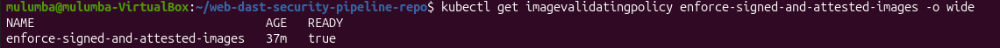
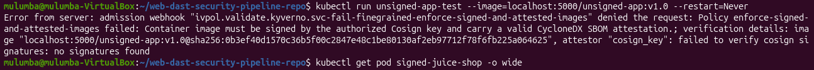
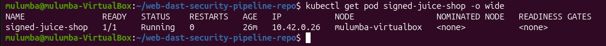

# Autonomous Container Supply Chain Attestation & Policy-as-Code Enforcement Report

## 1. Architecture & Supply Chain Security Controls

This phase establishes cryptographic provenance and runtime admission control for containerized workloads deployed to Kubernetes (`k3s`) using **Sigstore Cosign**, **in-toto CycloneDX SBOM Attestations**, and **Kyverno v1.20 (`ImageValidatingPolicy`)**.

| Control Layer | Implementation | Cryptographic / Policy Artifact |
| :--- | :--- | :--- |
| **Immutable Artifact Registry** | Local OCI Registry (`localhost:5000`) | `localhost:5000/juice-shop@sha256:aeb28af19303bb9e0437c2c82b5ab223bc8da56dc73472343be04aacca7e3143` |
| **Image Signing** | Sigstore Cosign (`ECDSA-P256`) | Detached OCI signature (`sha256-aeb28af1...sig`) verified with `cosign.pub` |
| **SBOM Provenance Attestation** | CycloneDX `bom.json` wrapped in in-toto DSSE envelope | Attached OCI attestation (`sha256-aeb28af1...att`, predicate `https://cyclonedx.org/bom`) |
| **Admission Enforcement** | Kyverno v1.20 CEL `ImageValidatingPolicy` | `policies/kyverno-supply-chain-policy.yaml` (`validationActions: [Deny]`) |

---

## 2. Cryptographic Signing & Attestation Workflow

1. **Digest-Pinned Image Publication:** OWASP Juice Shop was pushed to the local OCI registry (`localhost:5000/juice-shop:v1.0`) and resolved to its immutable SHA-256 manifest digest (`sha256:aeb28af19303bb9e0437c2c82b5ab223bc8da56dc73472343be04aacca7e3143`) to prevent tag mutation attacks.
2. **Cosign Image Signature:** Signed the immutable digest using `cosign sign --key cosign.key` and verified cryptographic integrity with `cosign verify --key cosign.pub`.
3. **CycloneDX SBOM Attestation:** Bound the Phase 3 CycloneDX SBOM (`bom.json`) directly to the container image digest via `cosign attest --key cosign.key --predicate bom.json --type cyclonedx`, creating a verifiable `application/vnd.in-toto+json` DSSE statement stored alongside the image in the OCI registry.

---

## 3. Kubernetes Admission Policy Enforcement (`Kyverno v1.20`)

The cluster-wide `ImageValidatingPolicy` (`enforce-signed-and-attested-images`) intercepts all `CREATE` and `UPDATE` operations for Pods (and auto-generates rules for Deployments, ReplicaSets, StatefulSets, DaemonSets, Jobs, and CronJobs). Using Common Expression Language (CEL), the admission webhook enforces two mandatory conditions before scheduling any container:

- `verifyImageSignatures(image, [attestors.cosign_key]) > 0` — Confirms a valid Cosign signature matching `cosign.pub`.
- `verifyAttestationSignatures(image, attestations.cyclonedx_sbom, [attestors.cosign_key]) > 0` — Confirms a signed in-toto CycloneDX SBOM attestation (`https://cyclonedx.org/bom`).

---

## 4. Admission Control Verification Results

| Test Case | Target Image | Policy Evaluation | Result |
| :--- | :--- | :--- | :--- |
| **Negative Test (`unsigned-app-test`)** | `localhost:5000/unsigned-app:v1.0` (`sha256:0b3ef40d...`) | `attestor "cosign_key": failed to verify cosign signatures: no signatures found` | **DENIED (`Forbidden`)** by `ivpol.validate.kyverno.svc` |
| **Positive Test (`signed-juice-shop`)** | `localhost:5000/juice-shop@sha256:aeb28af1...` | Valid Cosign signature + valid CycloneDX SBOM attestation verified | **ADMITTED (`1/1 Running`)** |

---

## 5. Key Operational & Troubleshooting Findings

- **k3s Air-Gapped / Throttled Registry Routing:** Configured `/etc/rancher/k3s/registries.yaml` to map `localhost:5000` over HTTP (`172.17.0.1:5000`) and patched `kyverno-admission-controller` with `hostNetwork: true` (`ClusterFirstWithHostNet`) so the admission webhook resolves `localhost:5000` directly against the host OCI registry.
- **Kyverno v1.20 Policy Migration:** Migrated from legacy `kyverno.io/v1` `ClusterPolicy` (removed for execution in Kyverno v1.20) to the native CEL-based `policies.kyverno.io/v1` `ImageValidatingPolicy` API.
- **Private Key Hygiene:** Excluded `cosign.key` via `.gitignore` so only the public verification key (`cosign.pub`) and declarative policy YAML are version-controlled.

---

## 6. Visual Verification Evidence

### 6.1 Active Kyverno v1.20 `ImageValidatingPolicy` (`READY: true`)

### 6.2 Negative Admission Test — Unsigned Container Image Denied

### 6.3 Positive Admission Test — Signed & CycloneDX-Attested Image Admitted (`1/1 Running`)

